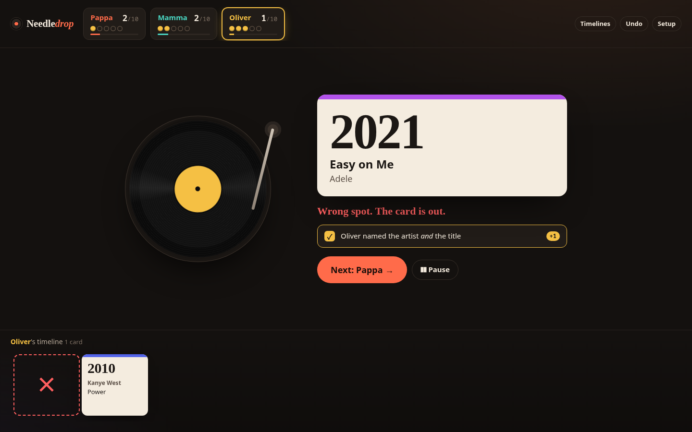
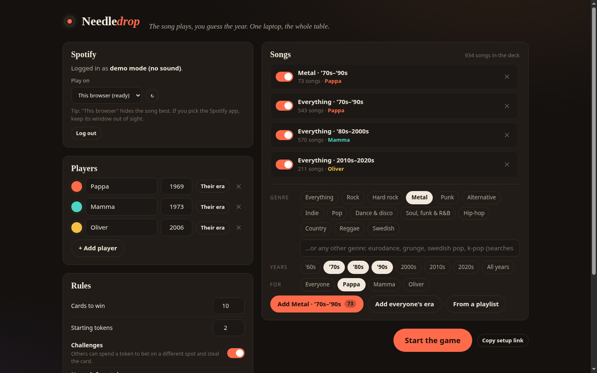
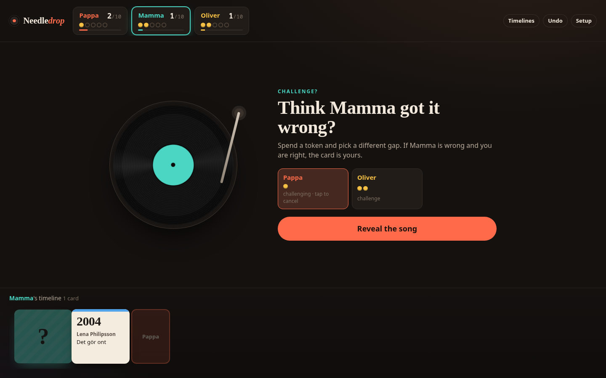

# Needledrop

[](https://github.com/Tjabooo/needledrop/actions/workflows/ci.yml) [](https://github.com/Tjabooo/needledrop/releases) [](LICENSE)

A music timeline party game for one laptop: Spotify plays a mystery song, the player whose turn it is slots it into their timeline by release year, and the first to build a timeline of 10 cards wins.

Made for mixed-age game nights: each player can get songs from the years they grew up with, so a metal fan born in 1969 and a pop kid born in 2006 both have a fair shot.



## Features

- **One device, whole table.** Pass-and-play on a laptop: big type, keyboard shortcuts, no phones or cards needed.
- **Plays through Spotify.** In the browser itself (Web Playback SDK), or on any Spotify app on the network (Spotify Connect). Nothing on screen gives the song away until the reveal.
- **Song packs in two clicks.** Pick a genre and one or more decades: *Metal · '70s–'90s*, *Swedish · 2010s*, *Everything · '80s–2000s*.
  - ~1000 hand-picked hits with their original release years (1961–2024) across rock, hard rock, metal, punk, alternative, indie, pop, dance & disco, soul/funk/R&B, hip-hop, country, reggae and Swedish music.
  - Any other genre ("eurodance", "grunge", "k-pop") pulls songs from Spotify search for the chosen decades.
  - Any playlist you made on Spotify.
- **Each player's era.** Enter birth years and press *Add everyone's era*: every player gets the songs from when they were roughly 8 to 28. Turn on *Everyone gets their own music* and each turn draws from that player's packs.
- **Rules you know:** starter card each, tokens for naming artist + title, spend a token to skip a song or challenge someone's placement and steal the card, trade three tokens for a free card. Toggle any of them.
- **Leave out extreme metal** (on by default): skips death/black metal tracks.
- **Undo** for misclicks, and the game survives a page reload.
- **Setup links:** copy a link that carries players, packs and rules to another device.

| Setup | Challenge |
| --- | --- |
|  |  |

## How a turn works

1. The song starts playing. The active player clicks the gap on their timeline where it belongs (or uses ← →) and locks it in. Saying the artist and title out loud earns a token.
2. Anyone with a token can challenge: spend it and pick a different gap.
3. Reveal. A correct placement keeps the card; a wrong one goes to the first challenger who was right, otherwise it is discarded.
4. First to the target number of cards wins.

Keys: **space** play/pause · **← →** move between gaps · **enter** lock in / reveal / next · **U** undo.

## Requirements

- **Spotify Premium** for the account that plays the music (Spotify only allows playback control for Premium).
- A Spotify app Client ID (free, two minutes):
  1. Go to [developer.spotify.com/dashboard](https://developer.spotify.com/dashboard) and **Create app**.
  2. Tick **Web API** and **Web Playback SDK**, and set the Redirect URI to your site's address with a trailing slash, e.g. `https://music.example.com/` (or `http://127.0.0.1:8150/` locally).
  3. Put the Client ID in `.env` as `SPOTIFY_CLIENT_ID`, or paste it on the setup page.

  New Spotify apps start in Development Mode: up to five Spotify accounts can log in, and they must be added under *User Management* in the dashboard. The app owner's account always works.
- Node.js 20 or newer. No npm dependencies.

## Install

```sh
git clone https://github.com/Tjabooo/needledrop.git
cd needledrop
cp .env.example .env   # set SPOTIFY_CLIENT_ID (optional) and PORT
npm start              # http://127.0.0.1:8150
```

Put it behind any HTTPS reverse proxy or tunnel for use on other devices: Spotify only accepts `https://` redirect URIs (plus `http://127.0.0.1`).

### Windows boot task

`scripts/windows/deploy.ps1 -SetupTask` registers a scheduled task that starts the server at boot, then each run of `deploy.ps1` pulls, runs the tests, restarts it and checks `/api/health`.

## Configuration

| Variable | Default | What |
| --- | --- | --- |
| `PORT` | `8150` | HTTP port |
| `HOST` | `127.0.0.1` | Listen address |
| `SPOTIFY_CLIENT_ID` | empty | Default Spotify app for every visitor (each browser can still use its own) |

## Adding songs

The built-in library is `public/songs.txt`, one song per line:

```
1986 | Europe | The Final Countdown | hardrock rock swedish
```

Use the **original** release year (not a remaster or compilation). Tags: `rock hardrock metal extreme punk alt indie pop dance soul hiphop country reggae swedish`. `npm test` checks the file for duplicates and unknown tags.

## How it works

- Static page (`public/`) plus a tiny Node server (`server.js`) that serves it and `/config.json`.
- `public/game.js`: the rules as pure functions (placement, challenges, tokens, packs, deck building), shared with the tests.
- `public/spotify.js`: PKCE login (no client secret anywhere), the Web Playback SDK player, playback control and search.
- Library songs are matched to the original Spotify recording when drawn (live versions, remixes, remasters and compilations score lower) and cached in the browser. Songs from Spotify search get their year checked against the earliest release of the same song.
- Everything (players, packs, the running game) lives in the browser's localStorage.

## Tests

```sh
npm test           # rules + library checks
npm run test:e2e   # plays a silent demo game in headless Chromium (needs chromium)
```

Open `/?demo` to try the whole flow without Spotify (no sound).

## License

MIT
